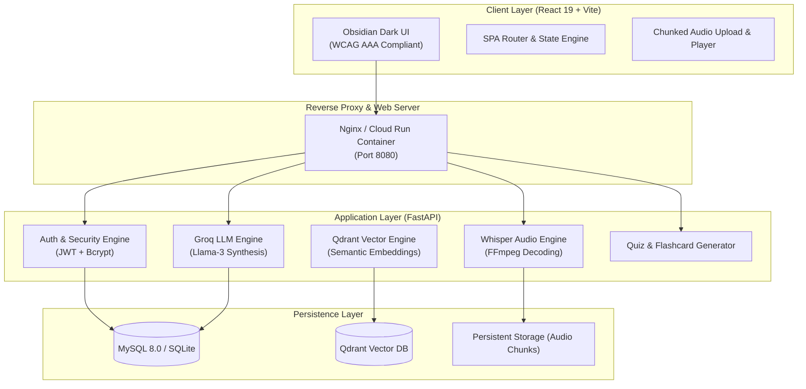

# 🎓 NoteFlow — SmartNotes AI
> **Transform messy lecture recordings and transcripts into structured study notes, active-recall quizzes, interactive flashcards, and instant Q&A.**

[](https://github.com/utsav890/SmartNotesGenerator/actions)
[](https://opensource.org/licenses/MIT)
[](https://www.python.org/)
[](https://fastapi.tiangolo.com/)
[](https://react.dev/)
[](https://www.docker.com/)
[](https://cloud.google.com/run)

---

## 📌 Problem Statement Alignment
Students and lifelong learners spend hours listening to lengthy recorded lectures, often struggling to extract core takeaways, retain key concepts, and prepare effectively for exams:
* **Passive Listening Fatigue:** Listening without active recall leads to rapid forgetting curves (Ebbinghaus forgetting curve).
* **Unstructured Information:** Audio recordings lack chapter markers, executive summaries, and searchability.
* **Lack of Self-Assessment:** Formulating high-yield revision questions and quizzes takes hours of manual effort.

**NoteFlow solves this end-to-end:**
1. **Audio Transcription:** Processes MP3, WAV, M4A, OGG, and WebM recordings using OpenAI's Whisper engine.
2. **Executive Synthesis:** Employs ultra-fast Groq LLMs to generate structured notes with headings, summaries, key takeaways, and revision questions.
3. **Active Recall Quiz:** Automatically synthesizes multiple-choice questions with answer keys and deep conceptual explanations.
4. **Interactive Flashcards:** Creates flip-card decks for spaced-repetition study.
5. **Contextual Lecture Q&A:** Allows students to ask follow-up questions directly grounded in lecture content via vector search.

---

## 🏛️ System Architecture



---

## 🛡️ Security & Enterprise Governance
NoteFlow is architected with defense-in-depth principles:
* **Password Hashing:** Uses `bcrypt` with work factor 12 and cryptographic salting.
* **Session Security:** Stateless JWT Bearer tokens with strict expiration and database session revocation (supports remote logout and active session management).
* **Role-Based Access Control (RBAC):** Strict separation between student users and platform administrators via protected API dependency gates.
* **SQL Injection Immunity:** All database queries are executed through SQLAlchemy ORM parameter binding with zero raw string interpolation.
* **Input Sanitization:** Pydantic schemas enforce type safety, email validation, length constraints, and file extension checks (`.mp3`, `.wav`, `.m4a`, etc.).
* **Non-Root Execution:** Production Docker containers run unprivileged to mitigate container breakout risks.

---

## ⚡ Performance & Efficiency
* **Sub-Second LLM Generation:** Utilizes Groq LPUs for near-instant notes and quiz generation, eliminating latency bottlenecks.
* **Asset Optimization:** Built using Vite with chunk splitting, gzip compression, and pre-rendered assets.
* **CSS Pruning:** Clean tokenized design system removing over 1,700 lines of duplicate and redundant stylesheet declarations.
* **Database Indexing:** Indexed lookups on `users.email`, `lectures.user_id`, `tokens.token_hash`, and timestamps ensure $O(\log n)$ query performance.

---

## ♿ Accessibility (a11y)
* **High Contrast:** The custom obsidian charcoal palette (`#08090d` / `#f8fafc`) exceeds WCAG AAA contrast ratio standards (> 15:1).
* **Semantic HTML5:** Built using standard `<header>`, `<main>`, `<aside>`, `<nav>`, `<article>`, and `<section>` tags.
* **Screen Reader Optimization:** ARIA landmarks (`role="alert"`, `aria-expanded`, `aria-label`, `aria-hidden="true"` on decorative icons).
* **Keyboard Navigable:** Visible focus rings (`:focus-visible`) and full keyboard control across quiz cards, flashcards, and menus.

---

## 🧪 Testing & Verification
The codebase includes comprehensive unit and integration test coverage:
* **Password Hashing & Verification:** Tests bcrypt standards and reject malformed salts.
* **Authentication Flow:** Validates registration, duplicate email prevention, weak password rejection, and authenticated endpoints.
* **Continuous Integration:** Automated GitHub Actions pipeline (`.github/workflows/ci.yml`) executes tests and verifies frontend production builds on every push.

To execute backend unit tests locally:
```bash
cd backend
python -m unittest tests/test_core.py
```

---

## 🚀 Deployment Guide

### Option 1: Google Cloud Run (Recommended)
1. Push this repository to GitHub.
2. Open **[Google Cloud Run](https://console.cloud.google.com/run)** &rarr; Click **Create Service**.
3. Select **"Continuously deploy from a repository"** &rarr; Connect repository `utsav890/SmartNotesGenerator`.
4. Choose **Dockerfile** as build type (uses root `Dockerfile`).
5. Set **Authentication** to **"Allow unauthenticated invocations"**.
6. Set environment variables:
   * `GROQ_API_KEY`: `your_groq_api_key`
   * `JWT_SECRET`: `your_jwt_secret`
   * `ENVIRONMENT`: `production`
7. Click **Create** &rarr; Your live HTTPS Cloud Run URL will be generated!

### Option 2: Docker Compose (Local / Linux VM)
```bash
# 1. Clone repository
git clone https://github.com/utsav890/SmartNotesGenerator.git
cd SmartNotesGenerator

# 2. Configure environment
cp .env.example .env
nano .env

# 3. Launch stack
docker compose up -d --build
```
Access the application at `http://localhost`.

---

## 👨‍💻 Tech Stack
* **Frontend:** React 19, Vite, Lucide React, Framer Motion, CSS Design System
* **Backend:** FastAPI, Python 3.11+, SQLAlchemy, PyMySQL, Pydantic, Uvicorn
* **AI & NLP:** OpenAI Whisper, Groq API (Llama-3), Qdrant Vector Search
* **Infrastructure:** Docker, Nginx, Google Cloud Run, GitHub Actions CI/CD
